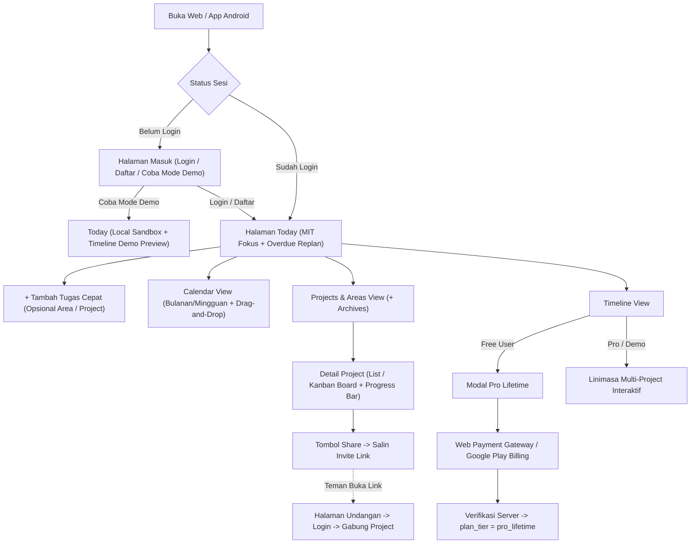

# PRD & Desain Produk: Aplikasi Manajemen Tugas & Proyek Lintas Platform (*Working Title: TaskFlow*)

**Tanggal:** 23 November 2026  
**Status:** Disetujui (*Approved*)  
**Skala Pekerjaan:** Proyek Aplikasi Utuh (*Full-Stack Web/PWA + Capacitor Android*)

---

## 1. Tujuan & Latar Belakang (*Intent & The Why*)
Aplikasi manajemen tugas yang **langsung siap pakai, bersih, dan responsif** untuk kalangan umum—siswa, mahasiswa, pekerja kantoran, hingga aktivitas harian/rumah tangga—tanpa perlu merakit struktur database dari nol seperti di Notion dan tanpa penumpukan fitur berat seperti di ClickUp atau Asana.

Dua target utama produk ini:
1. **Produk Komersial yang Sehat:** Versi **Gratis** yang sangat nyaman dipakai sehari-hari sebagai mesin akuisisi dan kolaborasi organik, dipadukan dengan paket **Pro Sekali Bayar (*Lifetime*)** yang ramah di kantong pelajar dan pekerja.
2. **Portofolio IT Unggulan:** Menampilkan rancangan *full-stack* lintas platform (Web/PWA + Android Play Store via Capacitor), kolaborasi *real-time*, *calendar/timeline scheduling*, validasi hak akses di server, dan *Demo Mode* instan bagi *recruiter*.

---

## 2. Goals, Non-Goals, & Anti-Goals

### Goals (Target V1)
- **Pencatatan Cepat (< 3 detik):** Pengguna dapat langsung mencatat tugas lepas (*Quick Task / Inbox*) tanpa wajib mengisi kategori atau membuat *Project*.
- **Organisasi Ramping (*PARA-Lite + GTD*):** Memisahkan bidang hidup yang berjalan terus (**Areas**), pekerjaan berbatas waktu (**Projects**), dan proyek selesai (**Archives**), tanpa kerumitan modul catatan dokumen (*Resources*).
- **Satu Data, Multi Tampilan:** Data tugas yang sama otomatis tersaji pada **Today** (gaya *MIT / Fokus Utama* + tombol cepat geser tugas terlambat), **Projects** (mode **List** & **Board Kanban**), **Calendar** (Bulanan & Mingguan dengan *Time-Blocking* opsional), dan **Timeline** (Pro).
- **Kolaborasi Ringan (*Share Project*):** Proyek atau tugas kelompok dapat dibagikan lewat tautan undangan dengan indikator progres otomatis.
- **Nyaman di Desktop maupun HP:** Optimal di layar lebar laptop sekaligus praktis di HP Android (Play Store via Capacitor & PWA) dan iOS (PWA).
- **Biaya Server Aman untuk Skema *Lifetime*:** Seluruh fitur Pro dipilih dari kapabilitas bernilai tinggi yang tidak menimbulkan biaya API/server berulang per pemakaian.

### Non-Goals (Ditunda ke Fase Lanjutan / Modular)
- **Fitur AI (*task breakdown*, *voice AI*) & Upload File Besar:** Dihindari pada V1 karena biaya API/penyimpanan bulanan berulang bertentangan dengan skema sekali bayar *Lifetime*. Catatan tugas mendukung penempelan tautan eksternal (Google Drive, Figma, Docs).
- **Modul Produktivitas Tambahan:** *Pomodoro timer*, *Habit tracker*, *Eisenhower Matrix* terpisah, dan bot pengingat WhatsApp/email ditunda sebagai modul opsional setelah inti produk matang.
- **Rilis Native iOS App Store di V1:** Pengguna iPhone/iPad mengakses lewat Web/PWA terlebih dahulu sebelum ekspansi ke App Store.

### Anti-Goals (Batasan Desain agar UX Tetap Ramping)
- **Tidak ada menu *Resources*, *wiki*, atau editor catatan panjang ala Notion** (cukup tempel tautan eksternal di catatan tugas).
- **Tidak ada *chat* internal, *video call*, atau *whiteboard*** di dalam aplikasi.
- **Tidak ada *custom fields* atau formula database rumit** buatan pengguna.
- **Tidak ada hierarki bersarang melebihi 3 lapis:** Struktur dibatasi tegas menjadi `Tugas Lepas` (opsional masuk `Area`) atau `[Area] → Project → [Section opsional] → Tugas`.

---

## 3. Kendala & Konteks Teknis (*Constraints*)
- **Validasi Paywall di Server:** Seluruh batas Gratis vs. Pro (*kuota Project aktif, kuota anggota, akses Timeline, tugas berulang, integrasi Google Calendar*) wajib divalidasi di backend/database agar tidak bisa diakali di klien.
- **Sinkronisasi Status Pro Lintas Platform:** Status `pro_lifetime` tersimpan pada akun pengguna di *cloud*. Pembelian melalui *payment gateway* Web maupun **Google Play Billing** (di aplikasi Android Play Store) harus memperbarui status akun yang sama agar fitur Pro terbuka di semua perangkat pengguna.
- **Kebijakan Google Play Store:** Akun developer personal baru di Google Play Console wajib melewati uji coba tertutup minimal **12 penguji aktif selama 14 hari berturut-turut** sebelum rilis publik, serta wajib memakai Google Play Billing untuk pembelian Pro di dalam aplikasi Android.
- **Akses Demo Portofolio Tanpa Hambatan:** *Recruiter* harus bisa mencoba aplikasi lewat tombol **"Coba Demo"** di halaman masuk web tanpa wajib registrasi email terlebih dahulu.

---

## 4. Pendekatan Platform yang Dipilih (*Approaches*)
Tiga opsi arsitektur telah dibandingkan:
1. **Web App + PWA Murni:** Tercepat dirilis dan bebas aturan toko aplikasi, tetapi tidak tampil di pencarian Google Play Store.
2. **Web App (PWA) + Bungkus Capacitor ke Google Play Store *(DIPILIH)*:** Membangun **1 basis kode Web/PWA responsif** sebagai produk utama untuk Laptop, browser HP, dan iOS (PWA), lalu membungkusnya dengan **Capacitor** menjadi paket Android (`.aab`) resmi untuk Google Play Store lengkap dengan akses plugin native (notifikasi lokal dan Google Play Billing).
3. **Cross-Platform *Mobile-First* (Flutter):** Kuat untuk aplikasi HP native, namun bundel Web-nya lebih berat saat dibuka lewat tautan *Share Project* atau oleh *recruiter* di browser laptop.

*(Pendekatan Mobile-only dan 3 codebase terpisah tidak diambil karena mengorbankan tampilan kalender/timeline desktop, mempersulit pembukaan link undangan, dan melipatgandakan beban pemeliharaan).*

---

## 5. Spesifikasi Fitur & Aturan Bisnis Lengkap

### 5.1 Entitas Inti (*PARA-Lite + GTD*)
1. **Areas (Ruang / Bidang Berkelanjutan):**
   - Wadah tingkat atas untuk memisahkan bidang kehidupan yang terus berjalan tanpa batas akhir (saat mendaftar, pengguna memilih *Area* awal dari preset: `Kuliah`, `Kantor`, `Pribadi` (tercentang bawaan), `Sekolah`, `Usaha`, `Organisasi`; minimal satu, dan "Lewati" memakai 3 bawaan — dapat ditambah, diubah nama, atau dihapus pengguna) `[Keputusan Desain 0.9]`.
   - Atribut: `Nama`, `Warna`, `Urutan`.
   - Fungsi: Menyaring seluruh *Project* dan *Tugas Lepas* di bidang tertentu dari *sidebar* atau filter tanpa mencampurkan urusan kuliah, pekerjaan, dan rumah.
2. **Tugas Lepas (*Quick Task / Inbox*):**
   - Berdiri sendiri (`project_id = null`), dan dapat dikaitkan ke satu `Area` secara **opsional** (`area_id = null` berarti masih di Inbox/umum agar pencatatan tetap < 3 detik).
   - Atribut: `Judul` (wajib), `Catatan` (opsional, tautan URL otomatis dapat diklik), `Prioritas` (`High`, `Medium`, `Low` dengan warna tegas), `Status` (`To-Do`, `In Progress`, `Done`), `Start Date` (opsional), `Due Date / Deadline` (opsional), `Due Time` (opsional — mendukung *Time-Blocking* ringan bila diisi).
3. **Project (Tugas Besar / Tugas Kelompok):**
   - Wadah untuk target berbatas waktu yang memiliki akhir jelas (`100%` selesai).
   - Atribut: `Nama Project`, `area_id` (opsional), `Deskripsi singkat`, `Warna identitas`, `Start Date` & `Due Date` proyek, status arsip (`is_archived` untuk memindahkan ke **Archives**).
   - Struktur internal: Daftar tugas yang dapat dibagi ke dalam **Section opsional** (misal: *Riset, Pengerjaan, Revisi*).
   - **Progress Bar Otomatis:** Dihitung dari persentase tugas berstatus `Done` terhadap total tugas di *Project* tersebut *(pengecualian untuk tugas berulang dijelaskan pada 5.2)*.

### 5.2 Aturan Tugas Berulang (*Recurring Tasks* — Fitur Pro)
- `[Keputusan Desain]` **Siklus *Advance-in-Place*:** Saat tugas berulang ditandai `Done`, sistem tidak membiarkan tugas selesai mengotori daftar aktif; sistem langsung memajukan `Start Date` / `Due Date` tugas tersebut ke tanggal siklus aktif berikutnya (misal Senin depan). Jika pengguna melewatkan beberapa siklus sebelumnya, jadwal tidak menumpuk puluhan baris *overdue*, melainkan bergerak ke siklus aktif terdekat/berikutnya agar daftar tetap rapi.
- `[Keputusan Desain]` **Proyeksi Kalender Virtual:** Pada tampilan *Calendar View*, jadwal berulang di masa mendatang dalam rentang minggu/bulan yang sedang dibuka ditampilkan secara visual (*read-only virtual occurrences*) tanpa menggandakan baris data sebelum siklus aktif tiba.
- `[Keputusan Desain]` **Interaksi dengan Progress Bar Project:** Jika tugas berulang dibuat di dalam sebuah *Project* (misal *"Rapat mingguan tiap Senin"*), tugas berulang tersebut **dikecualikan dari perhitungan persentase Progress Bar Project** agar *progress bar* proyek tetap akurat menuju 100% saat tugas-tugas non-rutinnya selesai.

### 5.3 Empat Tampilan Utama (*Views*)
1. **Today (Halaman Utama — Fokus Harian & *MIT* — Gratis):**
   - **Bagian Terlewat (*Overdue*):** Muncul rapi di atas jika ada tugas kemarin yang belum beres, dilengkapi tombol aksi cepat 1-klik **"Geser ke Hari Ini"** (terinspirasi *Bullet Journal Migrate / Replan*) untuk seluruh tugas terlambat maupun per item agar tidak memicu stres.
   - **Fokus Utama Hari Ini (*Gaya MIT / Eat the Frog*):** Menyorot tugas hari ini berprioritas `High` di kelompok teratas agar pengguna langsung tahu 1–3 hal terpenting sebelum mengerjakan tugas `Medium` dan `Low`.
   - Menampilkan seluruh tugas yang aktif hari ini (`Start Date <= Hari Ini <= Due Date` atau bertanggal hari ini), dilengkapi ringkasan progres harian dan tombol cepat **+ Tambah Tugas**.
2. **Projects, Areas, & Archives View (Gratis):**
   - Dapat difilter per **Area** (*Semua, Inbox Tanpa Area, Kuliah, Kantor, Pribadi*).
   - Memisahkan daftar **Tugas Lepas** dan **Daftar Project Aktif** (kartu berisi nama, badge *Area*, warna, *progress bar*, sisa hari ke *deadline*, dan jumlah anggota jika *Shared*).
   - Halaman detail **Project** mendukung dua mode tampilan lewat tombol *switcher* ringan **`List | Board (Kanban)`**:
     - **Mode List:** Dikelompokkan per *Section* (jika ada) atau datar, dengan filter status/PIC.
     - **Mode Board (Kanban):** 3 kolom baku (`To-Do` | `In Progress` | `Done`) yang bisa digeser (*drag-and-drop* di desktop atau ubah status cepat di HP).
   - Tersedia tab/filter **Archives** untuk menyimpan *Project* yang sudah selesai agar tampilan harian tetap bersih.
3. **Calendar View (Gratis):**
   - Mode **Bulanan** dan **Mingguan** yang menampilkan seluruh tugas bertanggal dan tenggat proyek.
   - Mendukung **drag-and-drop** tugas ke tanggal lain di desktop/web (dan aksi cepat pilih/geser tanggal pada layar sentuh HP).
   - Mendukung **Time-Blocking ringan secara opsional**: tugas yang diberi jam (`Due Time`) tampil berurutan/terblokir waktunya di mode mingguan, sementara tugas tanpa jam tetap tampil rapi di bagian *Sepanjang Hari* tanpa memaksa pengguna mengisi jam saat mencatat cepat.
   - Untuk pengguna Pro yang menghubungkan Google Calendar, agenda Google Calendar tampil di kisi kalender dengan gaya visual berbeda (*read-only badge*).
4. **Timeline View (Pro Lifetime):**
   - Linimasa horizontal (*lightweight Gantt*) pada skala **Mingguan / Bulanan** yang menampilkan rentang waktu (`Start Date` s.d. `Due Date`) beberapa **Project** sekaligus serta tugas-tugas berdurasi di dalamnya (dapat difilter per *Area*).
   - Mendukung geser batang atau tarik ujung batang untuk memperpanjang/memperpendek jadwal langsung di linimasa.
   - *Untuk pengguna Gratis di menu Timeline Utama:* Menampilkan pratinjau visual terkunci disertai tombol penawaran **Upgrade Pro Sekali Bayar**.

### 5.4 Kolaborasi (*Share Project*) & Aturan Kuota
- **Alur Undangan:** Pemilik *Project* menekan **Share / Undang** → sistem membuat tautan undangan unik (`invite_token`) → pemilik bisa menyalin tautan, mereset tautan, atau mengeluarkan anggota kapan saja.
- **Aturan Kuota Proyek Aktif:**
  - Batas **maksimal 5 Project aktif** bagi pengguna **Gratis** **hanya menghitung Project yang dimiliki/dibuat sendiri (`owner_id`)** serta tidak diarsipkan (`is_archived = false`).
  - Pengguna Gratis **bebas bergabung** ke *Shared Project* milik teman tanpa menghabiskan kuota 5 *Project* pribadinya.
- **Hak Akses Fitur Pro di dalam *Shared Project*:**
  - Jika **pemilik *Project* berstatus Pro**, maka kuota anggota naik menjadi **maksimal 20 anggota**, dan seluruh anggota *Project* tersebut (termasuk teman yang masih akun Gratis) dapat membuka **tab Timeline khusus Project tersebut** serta melihat **Riwayat Aktivitas Proyek** (*siapa menyelesaikan/mengubah tugas apa*).
  - Jika **pemilik *Project* berstatus Gratis**, kuota anggota maksimal **3 orang** (termasuk pemilik), dan fitur Timeline/Riwayat Aktivitas di *Project* itu tetap terkunci kecuali pemiliknya upgrade ke Pro.
  - `[Keputusan Desain]` Menu **Timeline Utama** (gabungan lintas seluruh *Project* pribadi & tim) dan fitur Pro pribadi lainnya (*Recurring, Google Calendar Sync, Tema kustom, >5 Project sendiri*) tetap mengikuti status `plan_tier` akun masing-masing pengguna.

### 5.5 Pengingat (*Reminders* — V1 Lokal)
- **Mekanisme V1:** Menggunakan **notifikasi lokal di perangkat** (lewat plugin notifikasi lokal Capacitor pada aplikasi Android setiap kali data tugas tersinkronisasi di perangkat, dan notifikasi dalam aplikasi / browser permission saat Web/PWA sedang terbuka). Tidak menggunakan *remote cloud push scheduler* agar biaya server *Lifetime* tetap sangat rendah.
- **Gratis vs. Pro:** Gratis mendapat **1 pengingat dasar** per tugas bertanggal; Pro mendapat **pengingat kustom ganda** (misal H-1 dan 1 jam sebelum tenggat).
- `[Keputusan Desain]` **Pengingat di dalam *Shared Project*:** Pengingat pada perangkat otomatis dijadwalkan untuk tugas di mana pengguna adalah **PIC/Assignee** (atau pembuat tugas jika belum ada PIC), dan pengguna dapat mematikan/menyalakan pengingat tugas tersebut secara lokal tanpa memengaruhi anggota lain.

### 5.6 Sinkronisasi Google Calendar (Pro — 1-Arah)
- **Mekanisme V1:** **1-arah (*Read-Only Overlay*)** lewat koneksi OAuth Google Calendar.
- Agenda/acara dari Google Calendar yang dipilih tampil berdampingan di **Calendar View** dan **Timeline View** sebagai blok referensi (*read-only*) agar pengguna tidak menjadwalkan tugas bentrok dengan jadwal kuliah/rapat.
- Pengguna dapat menekan tombol **"Salin jadi Tugas"** pada acara Google Calendar untuk menjadikannya tugas yang bisa dicentang di aplikasi.

### 5.7 Mode Demo Portofolio (*Recruiter Sandbox*)
- **Penyimpanan Lokal Instan:** Tombol **"Coba Mode Demo"** di halaman masuk langsung membuka aplikasi berisi data contoh (*Areas: Kuliah, Kantor, Pribadi; Tugas Lepas; Project Pribadi; serta simulasi Project Kelompok berisi anggota dummy seperti "Anda", "Budi", "Siti"* `[Keputusan Desain]`) yang tersimpan di penyimpanan lokal browser (`localStorage`/IndexedDB) tanpa perlu daftar akun dan tanpa menulis ke database cloud.
- **Akses Fitur di Demo Mode:** Seluruh tampilan termasuk **Timeline View** dibuka dengan label **"Demo Preview"** agar *recruiter* dapat merasakan kualitas UI/UX penuhnya, sementara tombol aksi *Upgrade Pro* membuka **simulasi modal Checkout Pro** yang aman tanpa transaksi uang sungguhan (ditambah banner halus *"Data Demo hanya tersimpan di browser ini — Daftar gratis untuk menyimpan ke cloud & Share Project sungguhan"*).

### 5.8 Ringkasan Matriks Gratis vs. Pro (*Sekali Bayar / Lifetime*)

| Fitur / Kapabilitas | Gratis (*Free Core*) | Pro (*Sekali Bayar / Lifetime*) |
| :--- | :--- | :--- |
| **Tugas Lepas (*Quick Tasks*) & *Areas*** | Tak terbatas | Tak terbatas |
| **Tampilan *Today (MIT)*, *Projects (List & Kanban)*, & *Calendar*** | Penuh (Bulanan/Mingguan + *drag-and-drop*) | Penuh |
| **Tampilan *Timeline View*** | Terkunci di menu utama *(kecuali di dalam Shared Project milik pemilik Pro)* | **Penuh** (Lintas seluruh *Project* & tugas berdurasi) |
| **Kuota *Project* Aktif (Milik Sendiri)** | Maks. **5 Project aktif** *(Archives & project undangan teman tidak dihitung)* | **Tak terbatas** |
| **Kapasitas *Share Project*** | Maks. **3 anggota** per *Project* | Hingga **20 anggota** per *Project* + **Riwayat Aktivitas Proyek** |
| **Tugas Berulang (*Recurring*)** | Tidak tersedia | **Tersedia** (Harian, Mingguan pilih hari, Bulanan) |
| **Sinkronisasi Google Calendar** | Tidak tersedia | **1-Arah Overlay** + tombol *Salin jadi Tugas* |
| **Pengingat Lokal (*Reminders*)** | 1 pengingat dasar per tugas | **Pengingat Kustom Ganda** |
| **Tema Tampilan** | Terang & Gelap standar | Terang, Gelap, + **Palet aksen warna kustom** |

---

## 6. Alur Pengguna Utama (*User Flows*)



### Rincian Skenario Penting
1. **Bergabung via Link Undangan (`?invite=<token>` atau `/invite/<token>`):**
   - Jika teman belum login saat membuka link, token undangan disimpan sementara hingga proses login/daftar selesai, lalu sistem langsung memvalidasi kapasitas proyek (`< 3` jika pemilik Free, `< 20` jika pemilik Pro) dan mengarahkan teman ke halaman *Project* tersebut.
   - Jika kapasitas penuh, tampilkan pesan jelas beserta informasi bagi pemilik *Project*.
2. **Pembelian Pro (*Lifetime*):**
   - Pengguna menyentuh fitur Pro terkunci → melihat modal perbandingan manfaat dengan penekanan **"Sekali bayar, aktif selamanya"**.
   - Jika diakses melalui Web/PWA → diarahkan ke *payment gateway* web; jika diakses di dalam aplikasi Android Capacitor → memanggil Google Play Billing.
   - Setelah *webhook* atau verifikasi struk sukses di backend, `plan_tier` akun berubah menjadi `pro_lifetime` dan langsung berlaku di semua perangkat milik akun tersebut.

---

## 7. Struktur Navigasi & Sketsa Tata Letak Layar

### Desktop / Laptop (Layar Lebar)
```text
+--------------------+------------------------------------------+----------------------+
|  [TaskFlow]        |  TODAY - Senin, 23 Nov     [+ Tugas]     | Detail Tugas         |
|  [Cari cepat...]   |------------------------------------------| (muncul saat diklik) |
|                    |  (!) TERLAMBAT (1)  [Geser ke Hari Ini]  |                      |
|  * Today           |  [ ] Kirim revisi bab 2     [High] Kmrn  | Judul: [___________] |
|  # Calendar        |                                          | Area: [Kuliah v]     |
|  = Timeline [PRO]  |  FOKUS UTAMA (HIGH)                      | Project: [Tugas UAS] |
|                    |  [ ] Rapat tugas akhir     [High] 19:00  | PIC: [Budi v]        |
|  AREAS             |                                          | Prioritas: [High v]  |
|  - Kuliah          |  TUGAS LAIN HARI INI (2)                 | Tanggal: [23 Nov]    |
|  - Kantor          |  [ ] Beli paket data       [Low]  -      | Jam: [Opsional]      |
|  - Pribadi         |  [x] Review desain UI      [Med]  14:00  | Catatan: [_________] |
|                    |                                          | Pengingat: [+Tambah] |
|  PROJECTS (2/5)    |  RINGKASAN PROYEK AKTIF                  |                      |
|  o Tugas Akhir UAS |  Tugas Akhir UAS   [=======---] 70%      | [Simpan]    [Hapus]  |
|  o Renovasi Kamar  |                                          |                      |
|  ~ Archives        |                                          |                      |
|  [Upgrade Pro]     |                                          |                      |
+--------------------+------------------------------------------+----------------------+
```

### Mobile Web & Android Capacitor (Layar HP)
- **Header Ringkas:** Judul halaman aktif (`Today` / `Calendar` / `Projects` / `Timeline`), filter cepat **Area**, dan ikon avatar profil (berisi pengelolaan *Area*, tema, koneksi Google Calendar, & status Pro).
- **Area Konten:** Kartu/daftar bersih ramah sentuhan dengan tombol centang di kiri dan badge prioritas/tanggal di kanan; pada halaman detail *Project*, terdapat sakelar `List | Board` yang rapi.
- **Tombol Tambah Mengambang (*FAB `+`*):** Selalu mudah dijangkau di kanan bawah untuk *Quick Capture* dari tab mana saja.
- **Bottom Navigation Bar (4 Tab):** `Today` · `Calendar` · `Projects` · `Timeline`.
- **Edit Tugas:** Membuka *Bottom Sheet* dari bawah agar nyaman dioperasikan dengan satu tangan.

---

## 8. Model Data & Arsitektur Backend Konseptual
- **`users`**: `id`, `email`, `display_name`, `avatar_url`, `plan_tier` (`free` | `pro_lifetime`), `pro_source` (`web` | `google_play` | `manual`), `pro_purchased_at`, `theme_accent`, `created_at`
- **`areas`**: `id`, `user_id`, `name`, `color`, `sort_order`, `created_at` *(dibuat dari pilihan area awal saat pendaftaran, dapat disesuaikan pengguna)*
- **`projects`**: `id`, `owner_id`, `area_id` (nullable), `title`, `description`, `color`, `start_date`, `due_date`, `is_archived`, `invite_token`, `created_at`
- **`project_members`**: `project_id`, `user_id`, `role` (`owner` | `member`), `joined_at`
- **`project_sections`**: `id`, `project_id`, `title`, `sort_order`
- **`tasks`**: `id`, `creator_id`, `project_id` (nullable → `null` = Tugas Lepas), `area_id` (nullable → dipakai terutama untuk mengelompokkan Tugas Lepas ke *Area*), `section_id` (nullable), `assignee_id` (nullable), `title`, `notes`, `status` (`todo` | `in_progress` | `done`), `priority` (`high` | `medium` | `low`), `start_date`, `due_date`, `due_time`, `recurrence_rule` (nullable), `completed_at`, `sort_order`, `created_at`
- **`task_reminders`**: `id`, `task_id`, `user_id`, `offset_minutes` *(dipisah per pengguna agar aturan pengingat di Shared Project dan batas 1 vs. banyak pengingat dapat divalidasi per akun tanpa saling menimpa)*
- **`calendar_connections`**: `id`, `user_id`, `provider` (`google`), `encrypted_refresh_token`, `selected_calendar_ids`, `updated_at`
- **`activity_logs`**: `id`, `project_id`, `actor_id`, `action_type`, `summary`, `created_at`
- **`payment_transactions`**: `id`, `user_id`, `provider` (`web_gateway` | `google_play`), `external_transaction_id`, `amount`, `currency`, `status` (`pending` | `verified` | `refunded`), `created_at`

### Kebutuhan Keamanan & Sinkronisasi
- **Row-Level Security (RLS) / Otorisasi Server:** Pengguna hanya boleh membaca/mengubah `areas` dan tugas lepas miliknya sendiri, serta *Project* dan tugas di dalam *Project* tempat ia terdaftar di `project_members`.
- **Database/Edge Function Triggers untuk Kuota:** Cek jumlah `projects` aktif milik `owner_id` (`< 5` untuk Free), cek kapasitas `project_members` (`< 3` atau `< 20` berdasarkan `plan_tier` pemilik proyek), dan tolak penyimpanan `recurrence_rule` atau `task_reminders` > 1 bila akun bukan Pro.
- **Realtime Channel:** Subskripsi perubahan `tasks` dan `project_members` per `project_id` agar progres kolaborasi langsung muncul di layar anggota lain.

---

## 9. Hal yang Diserahkan ke Tahap Rencana Implementasi / Builder (*What's Left to the Builder*)
- Pemilihan *tech stack* spesifik (misalnya framework Web/PWA seperti React/Next.js atau Vite+React + Tailwind CSS, backend seperti Supabase/PostgreSQL atau setara, serta komponen Calendar, Kanban, dan Timeline ringan yang *touch-friendly* dan responsif).
- Penentuan nominal harga pasti paket **Pro Lifetime** (IDR untuk lokal dan/atau USD untuk global) serta integrasi *payment gateway* Web (misal Midtrans/Xendit atau Lemon Squeezy/Stripe).
- Perancangan skema SQL migrasi lengkap, fungsi *seed* 3 *Area* bawaan saat user baru mendaftar, RLS policies, *webhook* verifikasi pembayaran Web & Google Play Developer API, serta mekanisme *caching* OAuth token dan jadwal Google Calendar.
- Penyiapan proyek **Capacitor Android** (`@capacitor/core`, `@capacitor/android`, `@capacitor/local-notifications`, plugin Google Play Billing), ikon/splash screen, dan konfigurasi PWA (`manifest.json` + *service worker* untuk aset & pembacaan *offline* dasar).
- Desain sistem visual detail (palet warna, tipografi, komponen antarmuka, dan animasi mikro).
